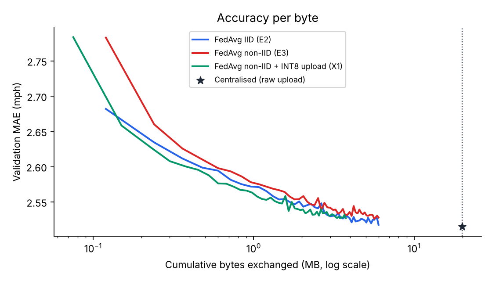
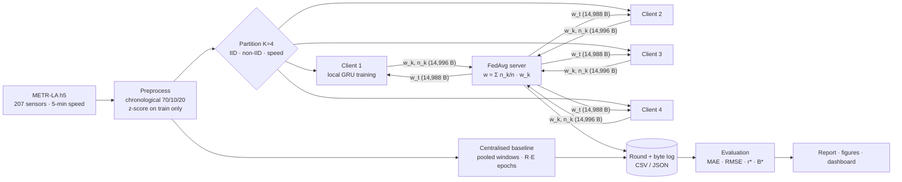

# NeuroForge · Federated Traffic-Flow Prediction with Communication-Cost Evaluation

**AIORI Hackathon 3 · Smart Cities · PS-003 · Team NeuroForge (A3-PS003-TC194)**

A reproducible simulator that answers one question with real data:

> **How much forecasting accuracy does federated learning give up, and how many bytes does it save, when traffic data stays at heterogeneous intersections?**

We train the *same* compact GRU forecaster three ways on the public METR-LA dataset (207 Los Angeles loop detectors, 5-minute speeds) and log **accuracy and bytes on one shared schema**, so every method is compared on *accuracy per byte*, not accuracy alone.

| | Centralised (E1) | FedAvg IID (E2) | FedAvg non-IID (E3) |
|---|---|---|---|
| Where raw data goes | all uploaded to one server | stays on 4 clients | stays on 4 clients (geographic) |
| What crosses the network | every training reading | model weights only | model weights only |

<!-- RESULTS:START -->
### Key findings

1. **FedAvg matches centralised accuracy with 30% of the bytes.** Test MAE: centralised 2.750, FedAvg IID 2.749, FedAvg non-IID 2.758 mph (3 seeds), for 6.00 MB of weights versus 19.86 MB of raw data.
2. **Geographic non-IID costs little; strong non-IID costs more.** Location-based clients add +0.009 mph over IID and need a few more rounds; clients split by speed level add +0.033 mph and never reach the 1% target in 50 rounds.
3. **INT8 update compression is almost free.** It cuts total traffic from 6.00 to 3.75 MB (37% less) for a +0.001 mph change in test MAE.
4. **Federation helps the intersections.** Training alone (zero bytes) gives 2.777 mph; joining FedAvg lowers it to 2.758 mph.
5. **FedAvg is not automatically cheaper.** A 50-round FP32 retraining costs as much as 25 days of raw streaming, so federated training saves bandwidth only if models are retrained less often than that.

### Headline results (test period, mean ± std over seeds 11 / 22 / 33)

| Method | Test MAE (mph) | Test RMSE (mph) | MAE @ +15 min | Bytes exchanged |
|---|---|---|---|---|
| Centralised (E1) | 2.750 ± 0.003 | 5.219 ± 0.017 | 3.049 ± 0.005 | 19.86 MB |
| FedAvg IID (E2) | 2.749 ± 0.001 | 5.226 ± 0.009 | 3.048 ± 0.003 | 6.00 MB |
| FedAvg non-IID (E3) | 2.758 ± 0.001 | 5.232 ± 0.007 | 3.061 ± 0.001 | 6.00 MB |
| Local-only non-IID (E4) | 2.777 ± 0.006 | 5.271 ± 0.009 | 3.077 ± 0.009 | 0 |
| FedAvg non-IID, E=5 (E5) | 2.772 ± 0.003 | 5.247 ± 0.014 | 3.075 ± 0.007 | 1.20 MB |
| FedAvg non-IID + INT8 upload (X1) | 2.759 ± 0.001 | 5.238 ± 0.003 | 3.061 ± 0.000 | 3.75 MB |
| FedAvg non-IID, 25% dropout (X2) | 2.755 ± 0.006 | 5.221 ± 0.014 | 3.056 ± 0.007 | 5.26 MB |
| FedAvg strong non-IID: speed quantiles (X3) | 2.783 ± 0.006 | 5.259 ± 0.018 | 3.091 ± 0.012 | 6.00 MB |

Bytes per FedAvg round (K = 4, FP32): **119,936 B**, logged = analytic in every round. Centralised training uploads **19.86 MB** of raw readings (= 166 FedAvg rounds).



Full analysis: [REPORT.md](REPORT.md)
<!-- RESULTS:END -->

## What is in this repository

```
fedtraffic/            the simulator (importable package)
  data.py              A+B  load METR-LA, validate, SHA-256, chronological 70/10/20 split, z-score on train only, lazy windows
  partition.py         C    clients: IID random · non-IID k-means on lat/lon · strong non-IID speed quantiles
  model.py                  GRU(32) + linear head = 3,747 parameters = 14,988 B
  engine.py                 one train_epoch() and one evaluate() used by every method (fair comparison)
  comm.py              E    nbytes() for every method, INT8/FP16 update codecs, link-time model
  simulate.py          D-G  clients, FedAvg coordinator, centralised baseline, local-only floor, logging
scripts/
  download_data.py          fetch METR-LA + sensor coordinates, verify SHA-256
  select_lr.py              learning-rate grid {1e-3, 3e-3, 1e-2} chosen on validation
  run_experiments.py   G    experiment matrix × seeds 11/22/33 (resumable, parallel)
  report.py            H    tables, figures, REPORT.md, results/summary.json
  build_site.py             static demo site (site/index.html) from the logs
  export_models.py          re-train seed-11 central + FedAvg, save weights for the in-browser explorer
  smoke.py                  3-round mentor demo: logged bytes vs 119,936 B formula
app/streamlit_app.py        interactive dashboard (results, cost planner, byte budget, live FedAvg)
tests/test_core.py          leakage, byte formula, FedAvg weighting, masking, codecs
results/                    per-run CSV logs + JSON summaries, figures, summary.json
docs/                       proposal PDF, problem statement, pseudocode
REPORT.md                   final evaluation report across 3 seeds
```

## Architecture



Solid arrows into and out of the server are the **only** traffic counted as bytes. Raw windows never leave a client.

## Quick start

```bash
python -m venv .venv && source .venv/bin/activate      # Windows: .venv\Scripts\activate
pip install -r requirements.txt
python scripts/download_data.py                        # ~57 MB, SHA-256 checked
pytest -q                                              # 8 tests
python scripts/smoke.py                                # 3 rounds, bytes == formula
```

Full reproduction (CPU only, roughly 2 hours on a 2-core laptop):

```bash
python scripts/select_lr.py                            # learning rate on validation
python scripts/run_experiments.py --suite all          # E1-E5 + extensions × 3 seeds
python scripts/report.py                               # REPORT.md + figures
python scripts/build_site.py                           # site/index.html
streamlit run app/streamlit_app.py                     # dashboard
```

## Design decisions that keep the comparison honest

* **No temporal leakage.** First 70 % of time trains, next 10 % validates, last 20 % tests; windows are built inside each period and a unit test asserts `max(train) < min(val) < min(test)`.
* **Same everything.** Same model, features, masked-L1 loss, Adam, batch size, learning-rate grid and selection rule for every method; centralised trains for R·E epochs so both see the data the same number of times.
* **Validation-only selection.** The best round is chosen on validation; the test period is evaluated exactly once.
* **One byte counter.** `comm.nbytes()` is the only function that counts payloads; a unit test checks the logged total equals `2·K·|w|·R + 8·K·R`.
* **Missing data.** METR-LA stores missing readings as 0 mph; they are masked in the loss and in every metric, and filled inside the input window by forward-fill (else the training mean).

## Innovation beyond the brief

0. **Live forecast explorer (our USP).** The two trained GRUs (federated non-IID and centralised, seed 11) are exported to `results/models/*.json` and run **inside the demo web page**. Click any of the 207 sensors and compare their +5/+10/+15-minute forecasts with the measured speed on two unseen test days. The browser implementation matches PyTorch to within 0.00001 mph (`scripts/export_models.py` re-trains them and checks the test MAE matches the logged run exactly).
1. **Communication-aware evaluation framework.** One log schema for every method → accuracy-vs-bytes curves, bytes-to-target `B*`, and rounds-to-target `r*` (target τ = 1.05 × best centralised validation MAE).
2. **Update compression (X1).** INT8 quantisation of the update *delta* cuts the upload by ~4× with a measured accuracy cost.
3. **Unreliable networks (X2).** Clients drop out after download with probability 0.25; a 2/10 Mbit/s link model converts bytes into round time.
4. **Strong non-IID stress test (X3).** Clients built from speed quantiles, the proposal's documented fallback, to show where FedAvg starts to struggle.
5. **Byte-budget decision support.** Given a budget `B_max`, deploy the best validated checkpoint that fits — in the dashboard and the report.
6. **Cost planner.** Analytic FedAvg-vs-streaming bytes for any number of sensors, clients, model size, codec and retraining schedule.

## Live demo

* **Hosted demo:** _add your link here (Netlify or shared demo page)._
* `site/index.html` is a self-contained demo page (live in-browser forecasts from the trained models, replay of the logged federated rounds on the sensor map, accuracy-per-byte chart, results table, cost planner, byte-budget selector). Open it in a browser or serve it with GitHub Pages.
* `streamlit run app/streamlit_app.py` runs the dashboard locally, including a **live** short FedAvg training run.

## Limitations

METR-LA is aggregated highway speed, not trip logs, and its detectors are highway sensors rather than signalised junctions, so privacy is a simulated motivation. Sharing model updates is not a privacy guarantee (gradient leakage), and no differential privacy or secure aggregation is implemented. Bytes are tensor payloads; protocol overhead is excluded for every method alike. Three seeds give descriptive mean ± std, not significance tests.

## References

1. B. McMahan et al., *Communication-Efficient Learning of Deep Networks from Decentralized Data*, AISTATS 2017. https://proceedings.mlr.press/v54/mcmahan17a.html
2. Y. Li et al., *Diffusion Convolutional Recurrent Neural Network: Data-Driven Traffic Forecasting*, ICLR 2018. https://arxiv.org/abs/1707.01926 (METR-LA; data via github.com/liyaguang/DCRNN)
3. Y. Liu et al., *Privacy-Preserving Traffic Flow Prediction: A Federated Learning Approach*, IEEE IoT Journal 2020. https://arxiv.org/abs/2003.08725
4. T. Li et al., *Federated Optimization in Heterogeneous Networks (FedProx)*, MLSys 2020. https://arxiv.org/abs/1812.06127
5. Y. Zhao et al., *Federated Learning with Non-IID Data*, 2018. https://arxiv.org/abs/1806.00582
6. L. Zhu et al., *Deep Leakage from Gradients*, NeurIPS 2019. https://arxiv.org/abs/1906.08935

Code: MIT licence. Dataset: METR-LA as distributed with the DCRNN repository; check its usage terms before redistribution (the data file is not committed to this repository).
