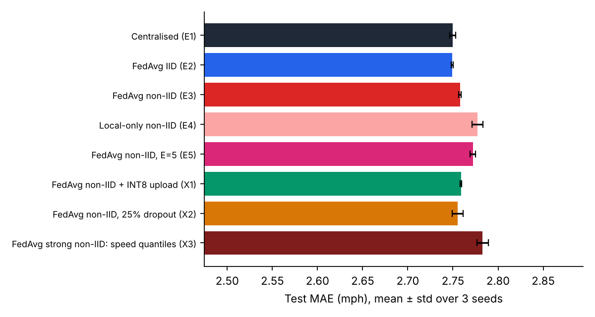
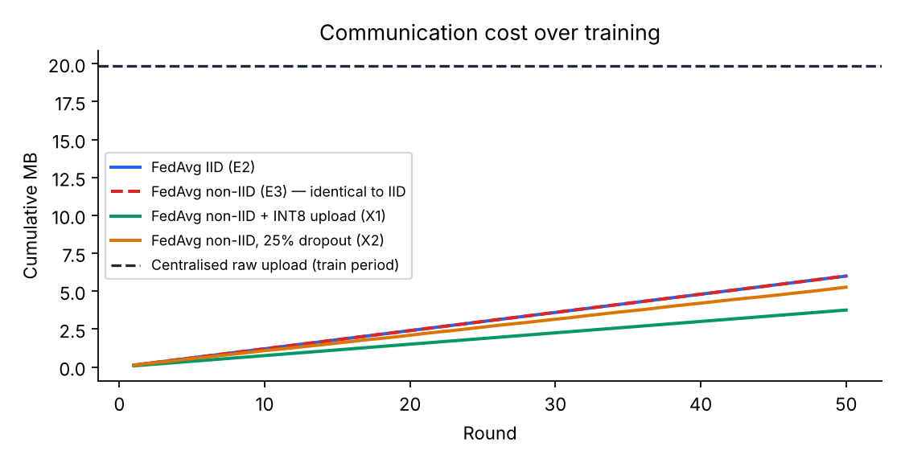
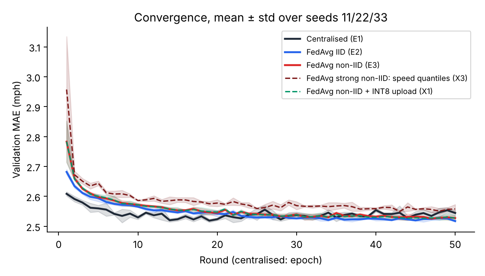
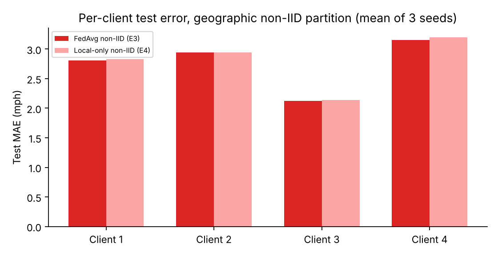
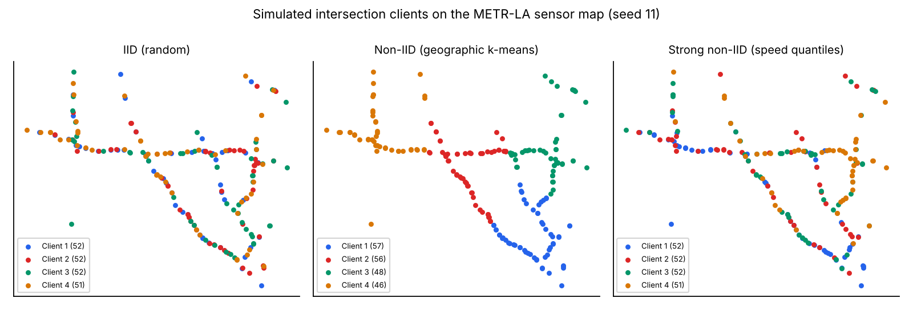

# Evaluation Report — Federated Traffic-Flow Prediction with Communication-Cost Evaluation

**Team NeuroForge · AIORI Hackathon 3 · PS-003 (A3-PS003-TC194)**

All numbers below are produced by `scripts/report.py` from the logs in `results/runs/`. Test-period numbers come from the validation-selected checkpoint of each run, evaluated once.

## Key findings

1. **FedAvg matches centralised accuracy with 30% of the bytes.** Test MAE: centralised 2.750, FedAvg IID 2.749, FedAvg non-IID 2.758 mph (3 seeds), for 6.00 MB of weights versus 19.86 MB of raw data.
2. **Geographic non-IID costs little; strong non-IID costs more.** Location-based clients add +0.009 mph over IID and need a few more rounds; clients split by speed level add +0.033 mph and never reach the 1% target in 50 rounds.
3. **INT8 update compression is almost free.** It cuts total traffic from 6.00 to 3.75 MB (37% less) for a +0.001 mph change in test MAE.
4. **Federation helps the intersections.** Training alone (zero bytes) gives 2.777 mph; joining FedAvg lowers it to 2.758 mph.
5. **FedAvg is not automatically cheaper.** A 50-round FP32 retraining costs as much as 25 days of raw streaming, so federated training saves bandwidth only if models are retrained less often than that.

## 1. Setup

* Dataset: METR-LA, 34,272 five-minute steps × 207 loop detectors, 2012-03-01 → 2012-06-27; missing readings (0 mph) re-measured on load: **8.11%**. SHA-256 `64784b76d6fb8ec9…`.
* Chronological split 70/10/20: train 23,990 steps (to 2012-05-23 07:05:00), validation 3,427, test 6,855. z-score fitted on training readings only (μ = 58.58 mph, σ = 12.82 mph).
* Model: one GRU (hidden 32) + linear head, 3,747 parameters = 14,988 B in float32; input 12 steps × 4 channels; outputs +5/+10/+15 min; masked L1 loss.
* FedAvg: K = 4 clients, full synchronous participation, E = 1 local epoch, R = 50 rounds; centralised baseline trains R·E = 50 epochs on pooled windows (equal data passes).
* Learning rate chosen on validation from the grid {1e-3, 3e-3, 1e-2} (8-round trials, seed 11): centralised **0.01**, FedAvg **0.01** (Adam, gradient clip 1.0, batch 1,024). The selected value is the largest in the pre-declared grid; we did not widen the grid after seeing results.
* Seeds 11, 22, 33 control initialisation, IID assignment, k-means initialisation and batch order. Results are mean ± sample std (n = 3).
* Compute budget (declared deviation): training windows use one anchor every 24 steps (120 min), per-round validation every 6 steps; the **test period uses every window**. All methods use the same strides, so the comparison stays fair.

## 2. Main results (RQ1, RQ2, RQ5)

| Method | Test MAE (mph) | Test RMSE (mph) | MAE @ +15 min | RMSE @ +15 min | Bytes exchanged |
|---|---|---|---|---|---|
| Centralised (E1) | 2.750 ± 0.003 | 5.219 ± 0.017 | 3.049 ± 0.005 | 5.964 ± 0.021 | 19.86 MB |
| FedAvg IID (E2) | 2.749 ± 0.001 | 5.226 ± 0.009 | 3.048 ± 0.003 | 5.980 ± 0.011 | 6.00 MB |
| FedAvg non-IID (E3) | 2.758 ± 0.001 | 5.232 ± 0.007 | 3.061 ± 0.001 | 5.980 ± 0.008 | 6.00 MB |
| Local-only non-IID (E4) | 2.777 ± 0.006 | 5.271 ± 0.009 | 3.077 ± 0.009 | 6.025 ± 0.013 | 0 (no communication) |
| FedAvg non-IID, E=5 (E5) | 2.772 ± 0.003 | 5.247 ± 0.014 | 3.075 ± 0.007 | 5.991 ± 0.015 | 1.20 MB |
| FedAvg non-IID + INT8 upload (X1) | 2.759 ± 0.001 | 5.238 ± 0.003 | 3.061 ± 0.000 | 5.989 ± 0.006 | 3.75 MB |
| FedAvg non-IID, 25% dropout (X2) | 2.755 ± 0.006 | 5.221 ± 0.014 | 3.056 ± 0.007 | 5.971 ± 0.016 | 5.26 MB |
| FedAvg strong non-IID: speed quantiles (X3) | 2.783 ± 0.006 | 5.259 ± 0.018 | 3.091 ± 0.012 | 6.000 ± 0.022 | 6.00 MB |

* **RQ1 — gap to centralised.** FedAvg-IID is ±0.000 mph MAE (±0.0%) and FedAvg-non-IID +0.008 mph (+0.3%) relative to centralised training. RMSE gaps: +0.007 and +0.013 mph. In words: FedAvg matches centralised accuracy to within a few hundredths of a mph while exchanging 30% of the bytes.
* **RQ2 — non-IID effect.** ΔMAE (non-IID − IID) = +0.009 mph, ΔRMSE = +0.006 mph. Rounds to reach τ = 1.05 × best centralised validation MAE: IID [2, 2, 3], non-IID [3, 3, 3] (per seed). With a stricter 1% target (τ₁ = 1.01 × best centralised, added by us because the 5% target is reached almost immediately): IID [21, 17, 20], non-IID [27, 18, 22] ('None' = not reached in 50 rounds). Validation-curve volatility (sum of upward steps): IID 0.096 ± 0.009, non-IID 0.110 ± 0.025.
* **RQ5 — consistency.** Method ordering by test MAE per seed: seed 11: Centralised < FedAvg IID < FedAvg non-IID; seed 22: FedAvg IID < Centralised < FedAvg non-IID; seed 33: FedAvg IID < Centralised < FedAvg non-IID. FedAvg non-IID has the highest error in every seed; centralised and FedAvg IID swap places, which means their difference is within seed-to-seed noise.

## 3. Communication cost (RQ3, RQ4)

* Analytic per-round payload (K = 4): 4 × 14,988 B down + 4 × 14,996 B up = **119,936 B**. The simulator's logged bytes equal this value exactly in every full-participation round (unit test `test_logged_bytes_equal_formula`). IID and non-IID runs send identical bytes per round (H3 confirmed), because payload depends only on model size.
* 50 rounds = 6.00 MB (+ 96 B one-off z-score statistics). Centralised training instead uploads every training reading once: 207 × 23,990 × 4 B = **19.86 MB**, i.e. the cost of ≈166 FedAvg rounds. In continuous operation, raw streaming costs 238.5 kB per day forever, whereas FedAvg pays only when it retrains.
* **Bytes-to-target** (first round whose validation MAE ≤ 1.05 × best centralised): IID 0.28 MB (reached in 3/3 seeds), non-IID 0.36 MB (reached in 3/3 seeds), non-IID + INT8 0.23 MB (reached in 3/3 seeds).
* **Bytes-to-target at 1%:** IID 2.32 MB (3/3 seeds), non-IID 2.68 MB (3/3 seeds), FedAvg non-IID + INT8 upload 1.70 MB (3/3 seeds), FedAvg strong non-IID: speed quantiles not reached. For comparison, centralised training needs the full 19.86 MB raw upload before its first epoch.

## 4. Extensions (beyond the mandated scope, reported separately)

* **FedAvg non-IID + INT8 upload (X1)** — test MAE 2.759 ± 0.001 mph (+0.001 vs FedAvg non-IID), bytes 3.75 MB, simulated link time 7.4 s.
* **FedAvg non-IID, 25% dropout (X2)** — test MAE 2.755 ± 0.006 mph (-0.003 vs FedAvg non-IID), bytes 5.26 MB, simulated link time 9.6 s.
* **FedAvg strong non-IID: speed quantiles (X3)** — test MAE 2.783 ± 0.006 mph (+0.025 vs FedAvg non-IID), bytes 6.00 MB, simulated link time 9.6 s.
* **FedAvg non-IID, E=5 (E5)** — test MAE 2.772 ± 0.003 mph (+0.014 vs FedAvg non-IID), bytes 1.20 MB, simulated link time 1.9 s.
* **Local-only non-IID (E4)** — test MAE 2.777 ± 0.006 mph (+0.019 vs FedAvg non-IID), bytes 0.00 MB, simulated link time 0.0 s.

* X1 compresses only the *upload* (update delta w_k − w_t); downloads stay float32. X2 drops each client after download with probability 0.25 per round. X3 uses the proposal's documented fallback partition (quantiles of training mean speed) as a stress test. Link-time figures use a 2 Mbit/s uplink, 10 Mbit/s downlink, 60 ms RTT model and are illustrations, not measurements.

* **Who benefits from federation?** Per-client test MAE, FedAvg vs local-only (non-IID, 3-seed mean): client 1: 2.809 vs 2.828, client 2: 2.946 vs 2.945, client 3: 2.122 vs 2.142, client 4: 3.151 vs 3.195. FedAvg is better for client(s) [1, 3, 4]; a client whose own data is enough can lose slightly from sharing one global model, which is the classic personalisation trade-off.

## 5. Client heterogeneity check (seed 11, training period)

| Partition | Client | Sensors | Mean speed | Std | Share < 40 mph |
|---|---|---|---|---|---|
| iid | 1 | 52 | 58.97 | 12.77 | 9.6% |
| iid | 2 | 52 | 58.32 | 12.8 | 9.9% |
| iid | 3 | 52 | 58.42 | 12.95 | 11.4% |
| iid | 4 | 51 | 58.62 | 12.76 | 11.0% |
| noniid | 1 | 57 | 55.29 | 15.27 | 18.0% |
| noniid | 2 | 56 | 60.05 | 11.88 | 7.9% |
| noniid | 3 | 48 | 62.35 | 7.69 | 2.1% |
| noniid | 4 | 46 | 57.04 | 13.51 | 12.9% |
| speed | 1 | 52 | 50.28 | 15.76 | 24.6% |
| speed | 2 | 52 | 57.66 | 12.11 | 10.0% |
| speed | 3 | 52 | 61.52 | 9.3 | 4.8% |
| speed | 4 | 51 | 65.12 | 7.23 | 2.2% |

## 6. Byte-budget decision support (seed 11, non-IID)

| Byte budget | Best FP32 checkpoint | Best INT8 checkpoint |
|---|---|---|
| 0.5 MB | round 4, val MAE 2.610 | round 6, val MAE 2.600 |
| 1.0 MB | round 8, val MAE 2.578 | round 13, val MAE 2.557 |
| 2.0 MB | round 15, val MAE 2.550 | round 24, val MAE 2.539 |
| 6.0 MB | round 50, val MAE 2.520 | round 50, val MAE 2.521 |

## 7. Limitations (stated honestly)

* METR-LA holds aggregated 5-minute highway speeds, not trip logs, and its sensors are highway detectors, not signalised junctions; privacy is a simulated motivation, not a property of this data.
* Sharing model updates is not a privacy guarantee (gradient-leakage attacks exist); no differential privacy or secure aggregation is implemented.
* Byte counts are tensor payloads; protocol headers, TLS/TCP framing and retransmissions are excluded for every method.
* Training windows were subsampled for the CPU budget; absolute errors would likely fall slightly with every window, for all methods alike.
* n = 3 seeds: mean ± std are descriptive; no significance claims are made.

_Reproducibility: Python 3.13.17, PyTorch 2.14.1+cu130, NumPy 2.5.3, scikit-learn 1.9.1. Re-create everything with `python scripts/run_experiments.py --suite all && python scripts/report.py`._
