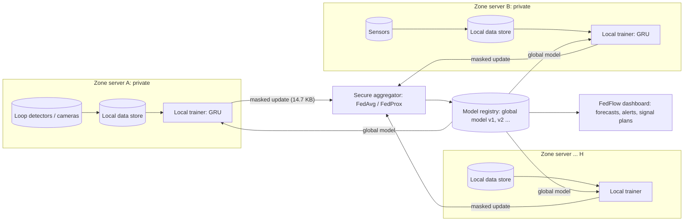
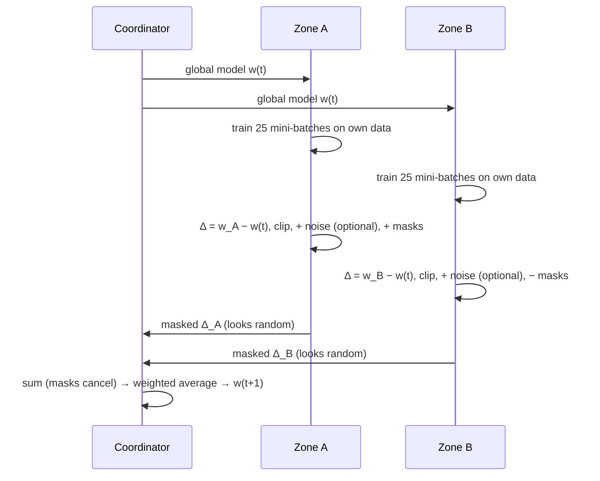
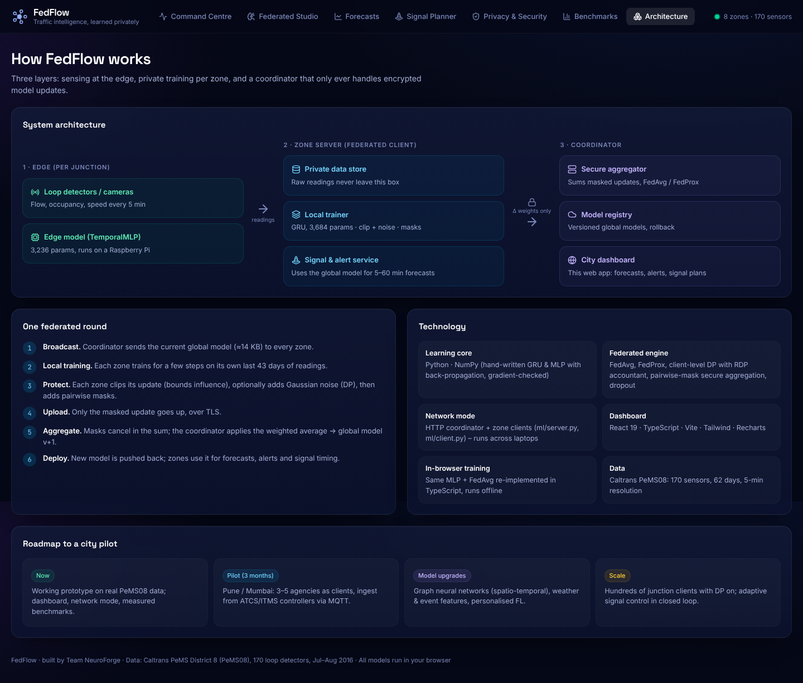
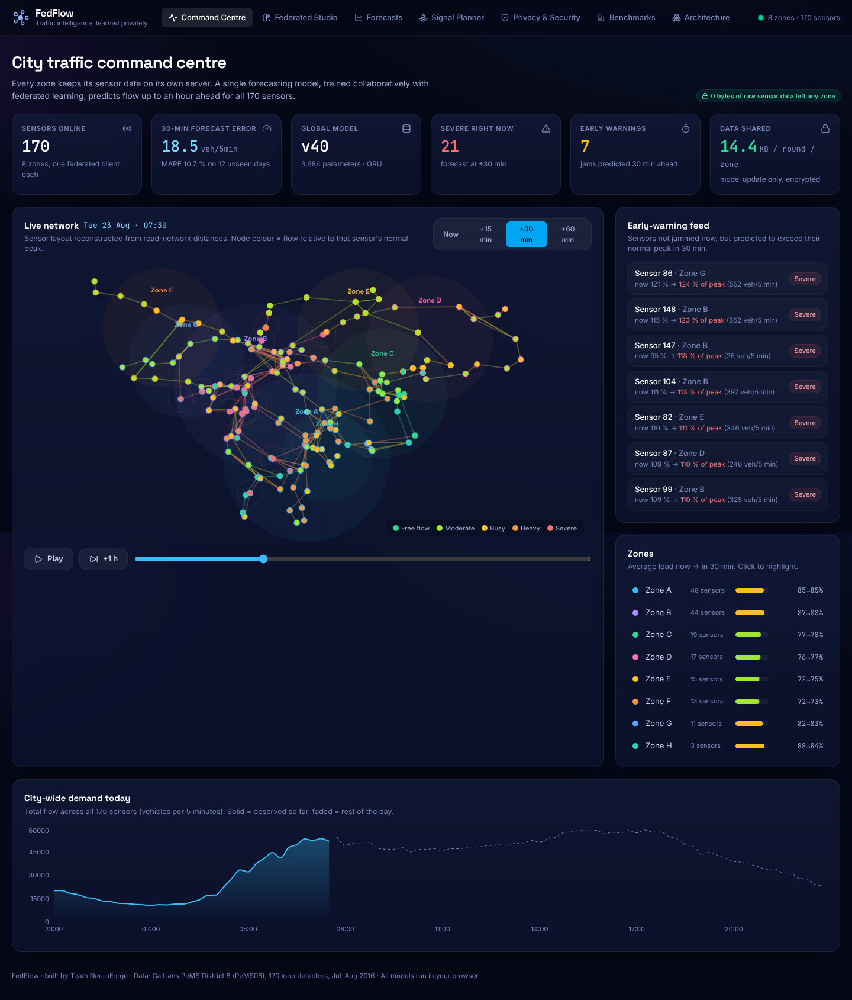
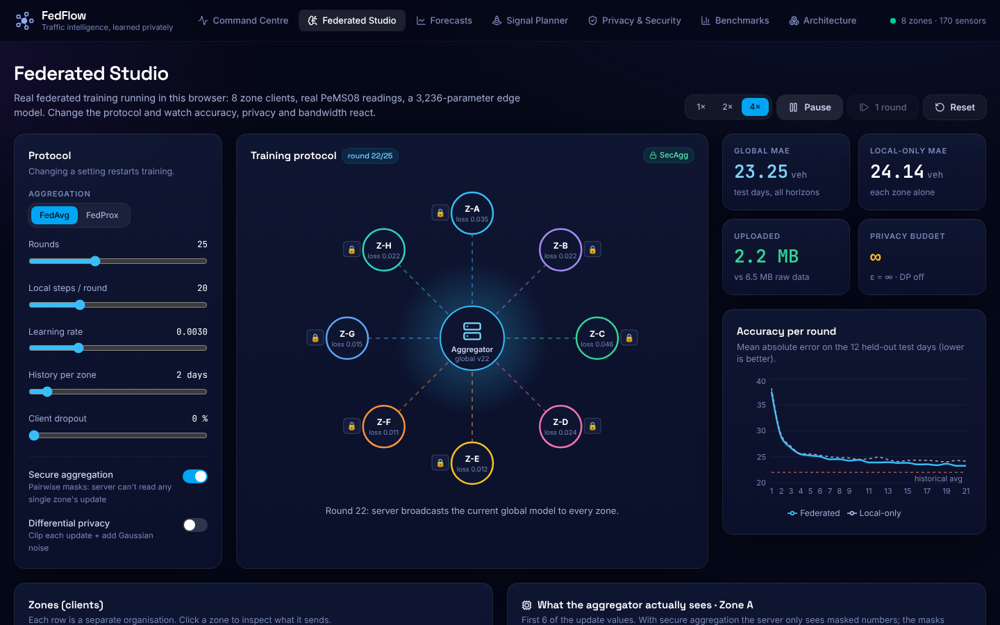
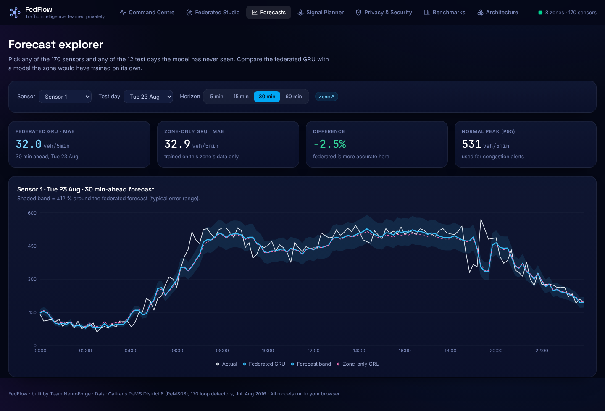
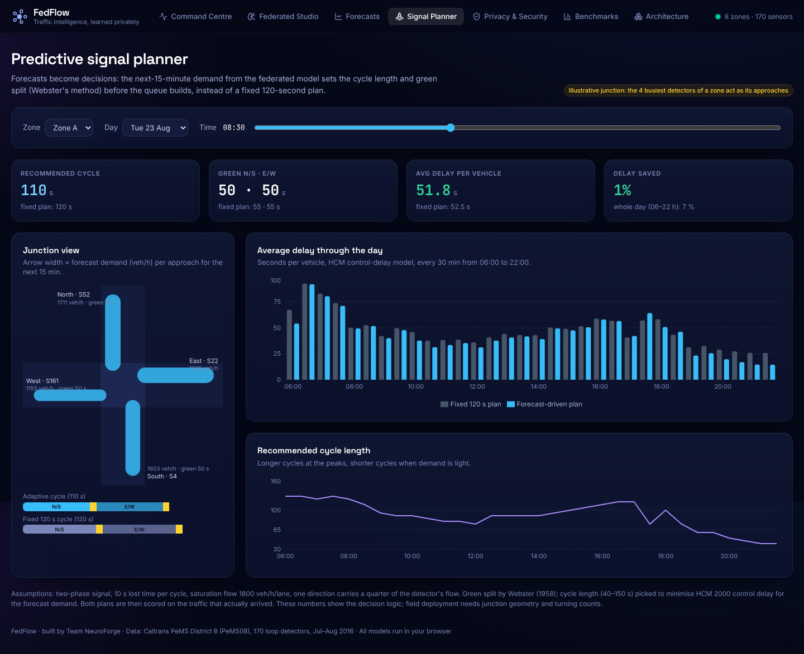
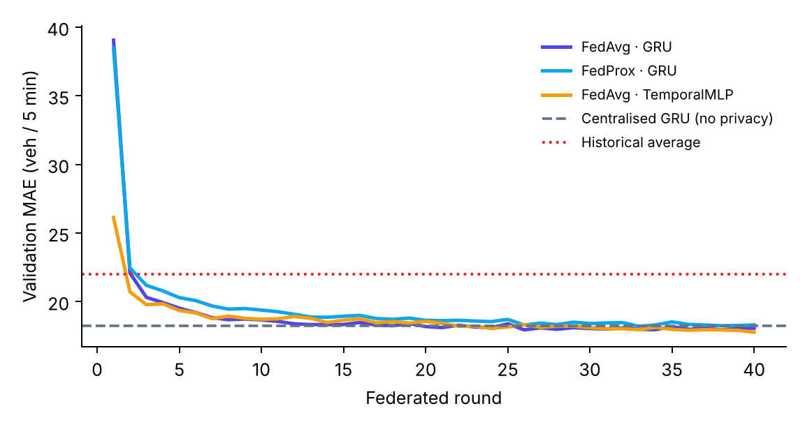
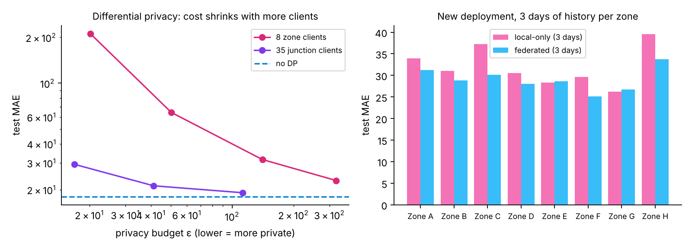

title: FedFlow
subtitle: Privacy-preserving traffic-flow forecasting with federated learning. Everything you need to present, defend and deploy it at the regionals.
tag: AIORI HACKATHON 3 · REGIONALS PREP BOOK
exam: <b>Team NeuroForge</b> · Team code A3-PS003-TC194<br>Mentor: Dr Zainab Mirza<br>Regionals: World Peace University, Pune · 16 November 2026
for: Read in this order: §1 pitch → §9 results cheat-sheet → §10 demo script → §11 judge Q&A. The rest is the deep explanation behind every claim.
short: FedFlow
color: #0369a1
css: .tip::before{content:"SAY THIS  "} .short::before{content:"REMEMBER  "} .warn::before{content:"BE HONEST  "} img{max-width:100%;border-radius:6px;border:1px solid #e2e8f0} .shot{page-break-inside:avoid;margin:2mm 0 3mm} .cap{font-size:8.4pt;color:#64748b;text-align:center;margin-top:1mm} .kpi{display:grid;grid-template-columns:repeat(4,1fr);gap:3mm;margin:3mm 0} .kpi div{border:1px solid #e2e8f0;border-radius:8px;padding:2.5mm 3mm;background:#f8fafc} .kpi b{display:block;font-size:16pt;color:var(--brand);font-family:Poppins,Inter} .kpi span{font-size:8.2pt;color:#64748b} .kpi{page-break-inside:avoid}

# 1. The project in one page

## The 60-second pitch (memorise this)

<div class="tip">Every city has traffic data, but it is split between agencies: the municipal corporation, the highway authority, toll operators, traffic police. Nobody is allowed to, or wants to, pool their raw data. So each one predicts traffic badly on its own. <b>FedFlow</b> lets all of them train <b>one shared forecasting model without any raw data ever leaving their own server</b>. Each zone trains locally and sends only an encrypted model update; our coordinator combines them with secure aggregation, so it cannot even read a single zone's update. On real data from 170 road sensors, the federated model predicts traffic 5 to 60 minutes ahead with an average error of about 18 vehicles per 5 minutes, <b>18% better than today's historical-average method and as accurate as pooling all the data centrally</b>. A brand-new zone with zero history gets a day-one model as good as one it could only train after a week of collecting data. And we turn the forecasts into action: early congestion warnings and signal timings that adapt before the queue builds.</div>

## What we built (the five things to point at)

| # | Piece | What it proves |
|---|---|---|
| 1 | **Federated learning engine** (Python, NumPy) | FedAvg, FedProx, secure aggregation, differential privacy with a privacy accountant, client dropout. Models with hand-written back-propagation, gradient-checked. |
| 2 | **Measured benchmarks** on PeMS08 | 10 methods compared on 12 unseen test days, 4 horizons; scarce-data, cold-start, DP-at-scale and dropout experiments. |
| 3 | **FedFlow web app** (7 screens) | Live city command centre, real federated training running in the browser, forecast explorer, predictive signal planner, privacy page, benchmarks, architecture. |
| 4 | **Network mode** (`server.py` + `client.py`) | Real federated training across separate machines over HTTP, with Diffie–Hellman-based secure aggregation. |
| 5 | **Deployable** | Static site: works offline on a laptop, or live on Vercel / Netlify / GitHub Pages in minutes. |

## Headline numbers

<div class="kpi"><div><b>17.99</b><span>federated GRU test MAE (veh / 5 min), avg of 5/15/30/60 min</span></div><div><b>18%</b><span>lower error than historical average (21.99)</span></div><div><b>1.3%</b><span>better than centralised training on pooled data (18.22)</span></div><div><b>0 bytes</b><span>of raw sensor data leave any zone</span></div></div>
<div class="kpi"><div><b>8.7%</b><span>error cut vs local-only when zones have only 3 days of data (up to 19% in one zone)</span></div><div><b>Day 1</b><span>a new zone with no data matches its own 7-day model</span></div><div><b>14.7 KB</b><span>per model update; 5.4× less data moved than shipping raw data</span></div><div><b>60%</b><span>zones offline per round and the error moves only 17.99 → 18.19</span></div></div>

# 2. The problem and why federated learning

## The problem statement in our words

Predict short-term traffic flow (vehicles per 5 minutes) at every sensor of a city, 5 to 60 minutes ahead, **when the data is distributed across organisations that cannot share it**. That last part is what makes it a federated-learning problem rather than an ordinary forecasting problem.

## Why data cannot simply be pooled

- **Ownership and law.** Different agencies own the sensors. India's DPDP Act 2023 pushes data minimisation and purpose limitation; camera / ANPR data can reveal movement of people.
- **Security.** One central database of a whole city's movement is a high-value target.
- **Politics and cost.** Agencies do not want to give away data; shipping and storing every raw reading centrally costs bandwidth and storage forever.

## Why each agency on its own is not enough

- A zone sees only its own roads, so it learns from fewer patterns (fewer peak-hour events, fewer incidents).
- **New zones have no history at all** (new sensors, new flyover, new smart-city ward). They cannot train anything for weeks.
- Small zones (our Zone H has only 3 sensors) are data-poor.

## Federated learning in one sentence

<div class="short">Instead of bringing the data to the model, bring the model to the data. Each zone trains a copy of the model on its own data and sends back only the change in the weights; the server averages the changes into a better global model and sends it back. Repeat.</div>

# 3. Architecture



Three layers:

1. **Edge / sensing**: loop detectors (or camera counts) aggregate vehicles every 5 minutes. Our small MLP model (3,236 parameters) is light enough for a Raspberry-Pi-class device.
2. **Zone server = federated client**: holds the zone's private data, trains locally, protects the update (clip → optional noise → mask) and serves forecasts for its own junctions.
3. **Coordinator**: only adds up masked updates, keeps versioned global models and feeds the city dashboard.

## One federated round



<div class="shot"><div class="cap">Architecture screen of the web app</div></div>

# 4. Data

## Dataset: PeMS08

| Property | Value |
|---|---|
| Source | Caltrans Performance Measurement System, District 8 (San Bernardino, California) |
| Sensors | 170 loop detectors on highways |
| Period | 62 days, 1 July – 31 August 2016 |
| Resolution | 5 minutes (288 readings per sensor per day), 17,856 time steps |
| Features | flow (vehicles / 5 min), occupancy, speed. We forecast **flow**. |
| Road graph | 295 sensor-to-sensor road distances (`distance.csv`) |

It is a standard benchmark used in published traffic-forecasting papers (ASTGCN, STSGCN and others), so judges can trust it, and results are comparable.

<div class="warn">This is US highway data, because no open Indian dataset has per-sensor 5-minute flows with a road graph. The pipeline is data-agnostic: an Indian city's ATCS / ITMS controller counts or camera counts drop in with the same format (sensor × time matrix + distance list).</div>

## Splitting the city into zones (the federated clients)

- We built the road graph from the distances (Gaussian kernel weights) and used **spectral clustering** to cut it into **8 geographically connected zones**. Each zone plays the role of one agency or ward.
- Zone sizes: 48, 44, 19, 17, 15, 13, 11, 3 sensors. They are deliberately **unequal (non-IID)**, like real agencies.
- A few sensors with no road links were attached to the zone whose traffic they correlate with most.
- PeMS08 has no GPS, so for the map we used **classical MDS** on shortest-path road distances to place sensors in 2-D. The picture is a faithful layout of the road network, not a geographic map.

## Time split (no leakage)

| Part | Days | Use |
|---|---|---|
| Train | first 43 days | local training on each zone |
| Validation | next 7 days | learning curves, choosing settings |
| Test | last 12 days | all reported numbers; never seen in training |

## Federated normalisation

Models train better on normalised data, but the mean and standard deviation of the whole city would normally need all the data. Each zone sends only **three numbers**: sum, sum of squares and count. The coordinator computes the global mean and std from those. No reading leaves the zone.

## Input to the model

For sensor *s* at time *t*: the last **12 readings** (one hour), time-of-day as sin/cos, and a weekend flag. Output: flow at **+5, +15, +30 and +60 minutes** (4 values at once).

# 5. Models

We wrote both models from scratch in NumPy, including back-propagation, because PyTorch could not be installed in our build environment. That also means the federated code operates on plain arrays, which is exactly what is exchanged.

## TemporalMLP (edge model, 3,236 parameters)

Input 15 features (12 lags + sin, cos, weekend) → 64 ReLU → 32 ReLU → 4 outputs. Fast; this is the model that trains live in the browser.

## GRU forecaster (main model, 3,684 parameters)

A gated recurrent unit reads the 12 time steps one by one (4 features per step: flow, sin, cos, weekend), hidden size 32, then a linear layer outputs 4 horizons.

<div class="formula">z_t = σ(x_t W_z + h_{t−1} U_z + b_z)        update gate
r_t = σ(x_t W_r + h_{t−1} U_r + b_r)        reset gate
n_t = tanh(x_t W_n + (r_t ⊙ h_{t−1}) U_n + b_n)
h_t = (1 − z_t) ⊙ n_t + z_t ⊙ h_{t−1}
ŷ   = h_12 W_o + b_o     (4 horizons)</div>

- Trained with back-propagation through time; the analytic gradients were **checked numerically** (relative error ≈ 4 × 10⁻⁷).
- Loss: **Huber** (robust to sudden spikes from incidents). Optimiser: **Adam**, learning rate 0.003.

<div class="short">Why a GRU? Traffic is a sequence; the GRU's gates decide how much of the last hour to remember. It has fewer parameters than an LSTM, which means smaller updates to send every round.</div>

# 6. Federated learning engine

## FedAvg

<div class="formula">w(t+1) = w(t) + Σ_k (n_k / n) · Δ_k ,   Δ_k = w_k − w(t)</div>

Each zone *k* trains 25 mini-batches (batch 128) from the current global model, then the server takes the sample-weighted average of the updates. 40 rounds.

## FedProx

Same as FedAvg, but the local loss gets a term (μ/2)·‖w − w_global‖² that keeps local models from drifting too far when zones are very different (non-IID). We use μ = 0.01. In our data FedAvg was slightly better, which tells us the zones are not extremely heterogeneous; FedProx is kept as an option for messier real deployments.

## Secure aggregation (pairwise masks)

Every pair of zones (i, j) agrees on a random vector m_ij. Zone i adds it, zone j subtracts it:

<div class="formula">sent_i = Δ_i + Σ_{j>i} m_ij − Σ_{j&lt;i} m_ji
Σ_i sent_i = Σ_i Δ_i       (every mask appears once with + and once with −)</div>

- The server sees vectors that look like noise (in our run a true update with norm 0.6 is sent with norm ≈ 870), but the **sum is exact**. Our code asserts that the masks cancel.
- **Network mode**: the shared masks come from **Diffie–Hellman key agreement** (2048-bit RFC 3526 group). Each zone publishes g^a; two zones compute the same secret g^(ab) without the server learning it, then expand it with SHA-256 into the mask. This is the Bonawitz et al. (Google, 2017) protocol, simplified (no dropout recovery in network mode).

## Differential privacy (client level)

1. **Clip**: each zone's update is scaled down so that its L2 norm ≤ C. This bounds how much any one zone can influence the model (also stops a faulty or malicious zone).
2. **Noise**: Gaussian noise with std σ·C is added to the sum (distributed: each zone adds a share σC/√m, which secure aggregation hides).
3. **Accounting**: a Rényi-DP accountant converts (σ, rounds) into a formal (ε, δ = 10⁻⁵) guarantee. Lower ε = stronger privacy.

## Robustness: client dropout

Every round, each zone can be offline with probability p. The round proceeds with whoever responds; weights are re-normalised. Tested up to 60%.

## What actually leaves a zone

| Leaves? | Item |
|---|---|
| Never | raw readings (flow, occupancy, speed), any per-vehicle data |
| Once | 3 aggregate numbers for normalisation |
| Each round | one masked, clipped model update (14.7 KB) |

# 7. The web app, screen by screen

Header shows only the product name **FedFlow** and the small line "Traffic intelligence, learned privately". Everything runs in the browser; no backend needed.

## 1 · Command Centre

<div class="shot"><div class="cap">City command centre: live network, early warnings, zone load, city-wide demand</div></div>

- Replays the 12 unseen test days for all 170 sensors with the **federated GRU running in the browser**.
- Toggle **Now / +15 / +30 / +60 min**: the map recolours with predicted congestion (flow relative to each sensor's normal peak, p95).
- **Early-warning feed**: sensors not jammed now but predicted to exceed their normal peak in 30 minutes. This is the "so what" of forecasting.
- KPIs: 30-min forecast error, global model version, data shared (14.4 KB per round per zone, 0 bytes of raw data).

## 2 · Federated Studio (the wow screen)

<div class="shot"><div class="cap">Real federated training in the browser. Here each zone has only 2 days of history: federated 23.25 vs local-only 24.14 after 22 rounds.</div></div>

- **Real training** of the TemporalMLP on real PeMS08 readings (6 sensors per zone, last 14 training days) with 8 clients.
- Animated protocol: broadcast → local training → upload with lock icons → aggregate.
- Controls: FedAvg / FedProx, rounds, local steps, learning rate, **history per zone**, client dropout, secure aggregation, differential privacy (clip, σ, live ε).
- Charts: global vs local-only error per round, with the historical-average line.
- **"What the aggregator actually sees"**: the real update, the masked numbers the server receives, and the exact sum.
- Live forecast chart that visibly improves every round.

<div class="tip">Drag "History per zone" down to 2 days and press Start: the federated line ends below the local-only line. That is the core argument of federated learning, shown live.</div>

## 3 · Forecasts

Any sensor, any test day, any horizon. Overlays actual flow, the federated GRU and the zone-only GRU, with error stats.

<div class="shot"><div class="cap">Forecast explorer: 30-minute-ahead forecast vs actual on an unseen day</div></div>

## 4 · Signal Planner

Turns forecasts into decisions. For an illustrative junction (the 4 busiest detectors of a zone as its approaches):

- Forecast demand for the next 15 minutes → green split by **Webster's method** (green ∝ critical flow ratio) and cycle length (40–150 s) chosen to **minimise HCM 2000 control delay**.
- Both the adaptive plan and a fixed 120 s plan are then **scored on the traffic that actually arrived** (fair test).
- Result on the example (Zone A, 23 Aug, 06:00–22:00): **about 7% less average delay** than a fixed plan, with longer cycles at peaks and short cycles at night.

<div class="shot"><div class="cap">Predictive signal planner</div></div>

<div class="warn">The junction is illustrative (PeMS sensors are highway detectors, not a real 4-arm junction), and the delay comes from a standard traffic-engineering formula, not a field trial. Say this before a judge does.</div>

## 5 · Privacy & Security

What leaves a zone, a worked 3-zone secure-aggregation example, the measured privacy–accuracy chart (8 vs 35 clients) and a threat model (curious server, model inversion, malicious zone, offline zone, eavesdropping, DPDP alignment).

## 6 · Benchmarks

All measured results from the Python pipeline (section 8) with tables and charts.

## 7 · Architecture

Diagram, one federated round, technology and the roadmap.

# 8. Results (all measured on the 12 unseen test days)

## All methods

MAE in vehicles per 5 minutes (lower is better). Private = raw data never pooled.

| Method | Private | 5 min | 15 min | 30 min | 60 min | **Average** |
|---|---|---|---|---|---|---|
| FedAvg · TemporalMLP | yes | 13.9 | 16.0 | 18.2 | 23.0 | **17.79** |
| **FedAvg · GRU** (main) | yes | 14.0 | 16.2 | 18.5 | 23.2 | **17.99** |
| FedProx · TemporalMLP | yes | 14.0 | 16.2 | 18.4 | 23.4 | 18.00 |
| Local-only · TemporalMLP | yes | 14.5 | 16.3 | 18.3 | 22.9 | 18.00 |
| Local-only · GRU | yes | 14.2 | 16.5 | 18.5 | 22.8 | 18.02 |
| Centralised · GRU | **no** | 14.7 | 16.5 | 18.9 | 22.8 | 18.22 |
| FedProx · GRU | yes | 14.3 | 16.5 | 18.6 | 23.6 | 18.23 |
| Centralised · TemporalMLP | **no** | 15.5 | 17.1 | 19.1 | 23.9 | 18.91 |
| Historical average | yes | 21.9 | 22.1 | 22.0 | 22.0 | 21.99 |
| Last value (persistence) | yes | 15.9 | 19.5 | 24.0 | 34.5 | 23.50 |

30-minute MAPE of the federated GRU: **10.7%**.

**How to read it:**

- Federated beats both standard baselines clearly: **18% below historical average, 23% below persistence**.
- Federated is **as good as centralised** (slightly better, 17.99 vs 18.22): no accuracy is lost for privacy. Federated averaging over different zones acts like a regulariser.
- With the full 43 days of history, a single zone can already train a decent model alone (local-only ≈ 18.0). The federated model matches it **with one shared model** for the whole city. The real gains come when zones have little data, which is the normal case for new deployments (next section).

<div class="shot"><div class="cap">Validation error per round: converges in ~10 rounds</div></div>

## Where federation really pays off

<div class="shot"><div class="cap">Left: DP cost falls sharply with more clients. Right: with 3 days of history each zone does better federated.</div></div>

**New deployment (scarce history).** Every zone has only its last few days of data.

| History per zone | Local-only MAE | Federated MAE | Error cut |
|---|---|---|---|
| 3 days | 32.00 | 29.23 | **8.7%** (up to 19.2% in Zone C, 15.3% in Zone F) |
| 7 days | 18.12 | 18.06 | 0.3% (parity) |

**Cold start (a zone with zero data).** We trained the federated model without one zone, then tested on that zone:

| Zone | Day-one federated MAE (zone never trained) | Zone's own model after 7 days of data |
|---|---|---|
| A (48 sensors) | 20.82 | 20.81 |
| B (44) | 17.69 | 17.58 |
| C (19) | 19.41 | 19.92 |
| D (17) | 16.34 | 16.30 |

<div class="tip">A brand-new ward joins the network and on day one gets a model as accurate as the one it could only build after collecting a full week of its own data.</div>

## Privacy–accuracy trade-off

| Setting | σ | ε (δ = 10⁻⁵) | Test MAE |
|---|---|---|---|
| 8 zones, clipping only | 0 | ∞ | 18.12 |
| 8 zones | 0.3 / 0.5 / 1 / 2 | 323 / 141 / 50 / 20 | 23.0 / 31.5 / 64.3 / 211.7 |
| 35 junction clients | 0 | ∞ | 18.43 |
| 35 junction clients | 0.5 / 1 / 2 | 113 / 41 / 17 | **19.1 / 21.2 / 29.3** |

<div class="warn">With only 8 participants, strong formal DP destroys accuracy, because the noise is shared by very few updates. With 35 clients the same noise level costs far less (σ = 1: MAE 21.2 instead of 64.3). ε values of 20–100 are weak guarantees by academic standards. So our default is <b>secure aggregation + clipping</b>, and DP is switched on when the network grows to hundreds of junction-level clients. This honesty usually impresses judges more than an unrealistic number.</div>

## Robustness and communication

| Zones offline per round | 0% | 20% | 40% | 60% |
|---|---|---|---|---|
| Test MAE | 17.99 | 17.98 | 18.02 | 18.19 |

- Model update: **14.7 KB** per zone per round (3,684 float32 values).
- Whole training (40 rounds × 8 zones): **4.7 MB uploaded vs 25.3 MB of raw data** (5.4× less). Raw data grows every day; the update size stays fixed.
- Full experiment suite: about 10 minutes on a laptop CPU, no GPU.

# 9. Cheat-sheet: numbers to have on your tongue

| Ask | Answer |
|---|---|
| Dataset | PeMS08: 170 sensors, 62 days, 5-min, Jul–Aug 2016 |
| Clients | 8 zones by spectral clustering (48/44/19/17/15/13/11/3 sensors) |
| Split | 43 train / 7 val / 12 test days |
| Model | GRU, hidden 32, 3,684 params; MLP 3,236 params |
| Horizons | 5, 15, 30, 60 minutes from the last 60 minutes |
| Training | 40 rounds × 25 local steps, batch 128, Adam 0.003, Huber |
| Main result | FedAvg GRU 17.99 MAE, 30-min MAPE 10.7% |
| vs baselines | −18% vs historical average (21.99), −23% vs persistence (23.50) |
| vs centralised | 17.99 vs 18.22: no loss for privacy |
| Scarce data | 3 days: 32.00 → 29.23 (−8.7%), up to −19% per zone |
| Cold start | zero-data zone ≈ its own 7-day model |
| DP | 35 clients, σ = 1, ε ≈ 41: MAE 21.2 |
| Dropout | 60% offline: 18.19 |
| Comms | 14.7 KB per update; 5.4× less than raw |
| Signals | ≈7% less delay vs fixed 120 s plan (illustrative) |

# 10. Demo script (7–8 minutes)

Have the app open full-screen **before** you are called, on the Command Centre, at 100% zoom. Keep a second tab on Benchmarks.

| Time | Screen | What to do | What to say |
|---|---|---|---|
| 0:00 | (no slide) | Face the judges | The 60-second pitch from §1. |
| 1:00 | Command Centre | Press Play; switch Now → +30 min | "This is 170 real sensors on days the model never saw. Every forecast you see comes from one model that no agency had to share data for. Switch to +30 min: these red nodes are jams we predict half an hour early." Point at the early-warning feed. |
| 2:00 | Federated Studio | Set History to 2 days, 4×, Start | "This is not a video. Eight zone clients are training right now in this browser on real data. Watch the protocol: broadcast, local training, encrypted upload, aggregation." |
| 3:00 | Studio, aggregator panel | Click Zone A in the table | "Here is what the server receives from Zone A: these amber numbers are random-looking, the real update is in green, and only the sum, in blue, is exact. The server cannot read any single zone." Point at the accuracy chart: federated below local-only. |
| 4:00 | Studio, DP toggle | Turn DP on, show ε | "We also support formal differential privacy, with an accountant that tells you exactly how much privacy is spent." |
| 4:30 | Forecasts | Pick a busy sensor, 30 min | "Forecast vs actual on an unseen day; federated vs a zone training alone." |
| 5:15 | Signal Planner | Move time slider over the morning peak | "Forecasts become decisions: cycle and green split adapt before the queue builds; about 7% less delay than a fixed plan in this example." |
| 6:00 | Benchmarks | Scroll the table, then the scarce-data card | "Measured on 12 unseen days: 18% better than historical average, equal to centralised. And where it matters most, new zones with 3 days of data, up to 19% lower error; a zone with no data gets a week-quality model on day one." |
| 7:00 | Architecture | | "It runs today as a static site and as a real client–server system over the network with Diffie–Hellman secure aggregation. Next: a pilot with 3–5 agencies in Pune or Mumbai." Thank the judges. |

## Optional live network demo (if they ask "is it really distributed?")

On your laptop: `cd ml && ./demo_network.sh` (1 coordinator + 3 zone processes). Or on two laptops on the same hotspot:

```
laptop 1:  python3 server.py --clients 2 --rounds 10
laptop 2:  python3 client.py --server http://<laptop-1-ip>:8000 --zone 0
laptop 1:  python3 client.py --server http://127.0.0.1:8000 --zone 1
```

The server log prints every masked update (random-looking numbers) and the aggregated norm; each client prints its true update size vs what it sent and, at the end, its test MAE.

## Backup plan

- No Wi-Fi needed: run `npm run preview` or open the built `dist` with any static server; fonts are bundled.
- Keep the live URL and the PDF on your phone. Keep screenshots (this book) as a last resort.
- If the Studio is slow on a weak laptop, use speed 1× and fewer local steps.

# 11. Judge Q&A (prepared answers)

## About federated learning

**Q: Why not just send all data to a central server?** Ownership, law (DPDP Act: data minimisation), security (one honeypot of city movement), and politics: agencies refuse. We showed it costs no accuracy: federated 17.99 vs centralised 18.22.

**Q: Can't the server reverse-engineer the data from the updates?** Updates can leak information, which is why we add secure aggregation (the server sees only the sum) and optional differential privacy with clipping and noise, with a formal ε from an RDP accountant.

**Q: What if a zone sends a bad or malicious update?** Clipping bounds any zone's influence. Roadmap: robust aggregation (coordinate-wise median / trimmed mean) and per-zone validation before accepting a new global model; the registry allows rollback.

**Q: What if a zone goes offline?** The round continues with responding zones. Measured: 60% offline only moves MAE from 17.99 to 18.19. (Network mode currently waits for all registered zones; production secure aggregation uses secret-shared mask recovery for dropouts, as in Bonawitz et al.)

**Q: FedAvg vs FedProx: why both?** FedProx stabilises training when clients are very different. On our zones FedAvg was slightly better, meaning heterogeneity is moderate; we keep FedProx for messier real data.

**Q: Your local-only model is almost as good. So why federate?** With full history, yes, and that is an honest finding. But (1) one shared model instead of eight to maintain, (2) with scarce data federation cuts error up to 19%, (3) a new zone gets a good model on day one, (4) every zone benefits from patterns it never saw (events, incidents elsewhere).

**Q: Your ε values are large. Is that real privacy?** Large ε is a weak formal guarantee, and we say so. With only 8 clients, strong DP is not practical; that is a known result. The trend we measured (35 clients: σ = 1 costs 21.2 vs 64.3 MAE) shows DP becomes viable at junction scale. Our default protection is secure aggregation + clipping.

**Q: How is secure aggregation done in practice?** Pairwise masks derived from Diffie–Hellman shared secrets (implemented in `client.py` with the 2048-bit RFC 3526 group and SHA-256), the same idea as Google's protocol used in Gboard.

## About the model and data

**Q: Why GRU and not a Graph Neural Network / Transformer?** Small, fast to send (14.7 KB), trains on CPUs at zone servers, and very competitive at these horizons. Spatio-temporal GNNs (e.g. ASTGCN, Graph WaveNet) are on our roadmap; in federated settings they need cross-zone graph information, which is an open research problem.

**Q: Why MAE?** It is in vehicles per 5 minutes, so a traffic engineer understands it directly. We also report RMSE and MAPE.

**Q: How do you avoid data leakage?** Strict time split: test days are the last 12 days, never used in training or tuning; normalisation uses only training data.

**Q: Why is PeMS (US) relevant for India?** It is the standard open benchmark with a road graph; Indian open data at this granularity does not exist publicly. The pipeline only needs a sensor × time matrix and a distance list, which ATCS / ITMS systems (e.g. Pune, Mumbai) already produce.

**Q: Indian traffic is heterogeneous (two-wheelers, autos). Does that matter?** Counts would be in PCU (passenger car units) from cameras; the model learns from whatever unit is supplied. Fine-tuning per city is natural in FL (personalised FL is on the roadmap).

**Q: Did you use a library like Flower or PySyft?** No. We implemented FedAvg, FedProx, secure aggregation and DP ourselves, and even the GRU back-propagation, so we understand and can explain every line. Flower would be the production transport layer.

**Q: How long does training take?** All experiments: about 10 minutes on a laptop CPU. A round in network mode takes well under a second per zone.

## About impact and deployment

**Q: Who would use this?** City traffic control rooms (smart-city ICCCs), traffic police, highway authorities, toll operators, navigation providers who want to collaborate without sharing data.

**Q: Hardware needed?** One modest server per agency (or a Raspberry-Pi-class box per junction for the small model) and one coordinator in a government cloud. No GPU.

**Q: How do the signals actually change?** The planner outputs cycle length and green split per 15-min window; controllers with adaptive interfaces (e.g. ATCS) accept such plans. Our numbers are from a traffic-engineering formula, not a field trial.

**Q: What is novel here?** An end-to-end system rather than a model: private multi-agency training (SecAgg + DP + dropout) on real data, live in-browser federated training, cold-start and scarce-data evidence, and a direct path from forecast to signal decision.

**Q: Business / adoption model?** Open-source core; pilot with a smart-city SPV; cost is one coordinator VM plus the agencies' existing servers.

# 12. Honest limitations and roadmap

| Limitation | What we would do next |
|---|---|
| US highway data, not Indian urban data | Pilot with Pune / Mumbai ATCS counts or camera PCU counts |
| Model sees only its own sensor's history | Spatio-temporal GNN; neighbour features shared securely |
| Network mode needs all zones each round | Secret-shared mask recovery (full Bonawitz protocol), TLS + auth tokens |
| Strong DP not practical with 8 clients | Junction-level clients (100s), better accounting (subsampling) |
| Signal planner illustrative | Junction geometry, turning counts, closed-loop control with SUMO simulation, then field trial |
| No attack testing | Robust aggregation, poisoning tests |

# 13. How we built it

1. **Problem framing**: chose a public, citable dataset with a road graph (PeMS08) and defined zones as agencies.
2. **Data pipeline**: loading, graph, spectral zones, MDS layout, windows, federated normalisation.
3. **Models from scratch**: MLP and GRU in NumPy with gradient checks, because PyTorch was unavailable; this also kept everything transparent.
4. **FL engine**: FedAvg → FedProx → secure aggregation (with a mask-cancellation assert) → DP + RDP accountant → dropout.
5. **Experiments**: baselines, per-zone, convergence, privacy sweep, dropout, communication; then scarce-data, cold-start and DP-at-scale scenarios.
6. **Export**: compact assets for the browser (flows as 16-bit integers, GRU weights as JSON).
7. **Web app**: React + TypeScript; ported the MLP, Adam and FedAvg to TypeScript for live training; GRU inference in the browser.
8. **Network mode**: HTTP coordinator and clients with Diffie–Hellman masks.
9. **Polish**: offline fonts, static build, screenshots, this book.

## Repository map

```
fedtraffic/
  ml/
    fedflow/data.py        PeMS loader, graph, zones, windows
    fedflow/models.py      TemporalMLP, GRU (forward + backward), Adam, Huber
    fedflow/fl.py          clients, FedAvg/FedProx, SecAgg, DP, accountant, baselines
    run_experiments.py     all benchmarks -> results/ and web/public/data/
    run_scenarios.py       scarce data, cold start, DP at scale
    server.py, client.py   networked FL over HTTP (+ demo_network.sh)
  web/
    src/engine/            data loading, models, federated simulator, forecasts (TypeScript)
    src/pages/             the 7 screens
    public/data/           exported assets
  docs/                    this book
```

# 14. How to get it live

## Run locally (offline, for the venue)

```
# once, with internet: install Node.js 20+ from nodejs.org
cd fedtraffic/web
npm install
npm run dev          # development, opens http://localhost:5173
# or the production build:
npm run build
npm run preview      # http://localhost:4173
```

## Option A: Vercel (recommended, 3 minutes)

1. Create a GitHub repository and push the `fedtraffic` folder.
2. Go to vercel.com → sign in with GitHub → **Add New → Project** → import the repository.
3. Set **Root Directory** to `web`. Framework preset: **Vite** (build `npm run build`, output `dist`).
4. Deploy. You get a link like `fedflow.vercel.app`. Every push redeploys.

## Option B: Netlify drag-and-drop (no Git needed)

1. `cd web && npm run build`.
2. Open app.netlify.com/drop and drag the `web/dist` folder onto the page.
3. You get a live link immediately; rename the site to `fedflow-…` in site settings.

## Option C: GitHub Pages

1. `cd web && npm run build`.
2. Push `dist` contents to a `gh-pages` branch (or use the "Deploy static content" GitHub Action with path `web/dist`).
3. Settings → Pages → source: `gh-pages`. The app uses relative paths (`base: './'`), so it works under `/<repo>/`.

## Running the Python side

```
cd fedtraffic/ml
pip install -r requirements.txt
python3 run_experiments.py      # ~10 min: benchmarks + web assets
python3 run_scenarios.py        # ~10 min: scarce / cold start / DP at scale
./demo_network.sh               # networked FL demo on one laptop
```

## Going to production (what to tell judges)

Coordinator on a government cloud VM (MeghRaj / NIC) behind HTTPS; each agency runs `client.py` (or a Docker container) next to its data; per-client keys; the dashboard stays a static site served from a CDN.
